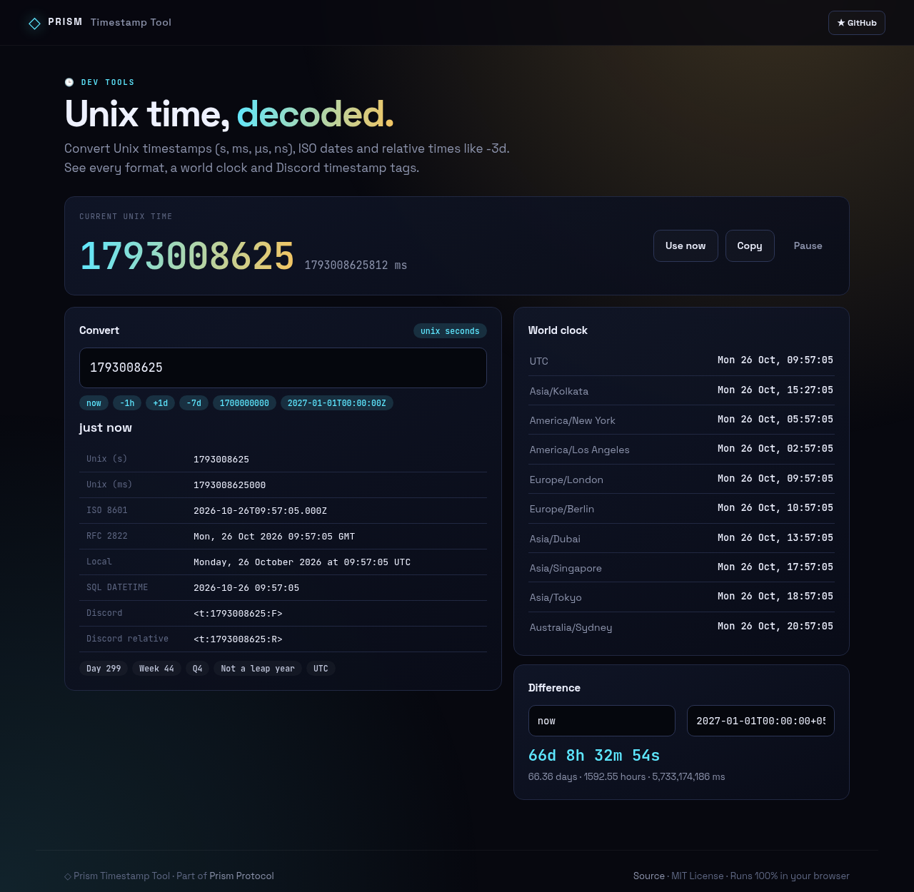
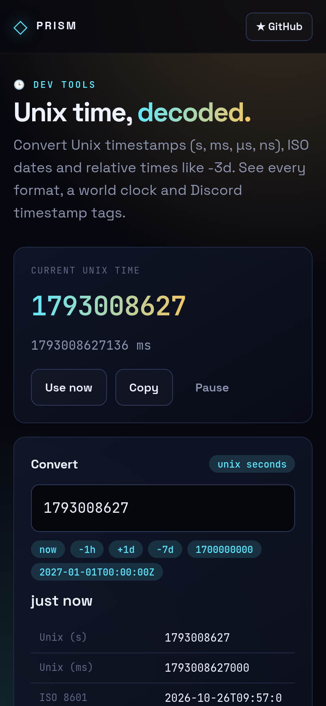

<!-- ═════════════ HEADER ═════════════ -->
<p align="center">
  
</p>

<p align="center">
  
</p>

<p align="center">
  <a href="https://github.com/krishyaa06/prism-timestamp-tool/actions/workflows/ci.yml"></a>
  <a href="https://krishyaa06.github.io/prism-timestamp-tool/"></a>
  
  
  <a href="LICENSE"></a>
</p>

<p align="center">
  
</p>


## ⚡ Overview

**Prism Timestamp Tool** converts between Unix time and human dates without guesswork. Paste a number and it detects whether it is seconds, milliseconds, microseconds or nanoseconds; paste an ISO string, `now`, or a relative value like `-2h` or `+3 days`. It shows the result in every useful format, including Discord timestamp tags, along with a live world clock and a date difference calculator.

## ✨ Features

- **Live Unix clock** with copy and pause
- **Smart input**: unix s/ms/µs/ns, ISO 8601, RFC 2822, `now`, relative (`-7d`, `+1 week`)
- **Formats**: Unix, ISO, RFC 2822, local, SQL DATETIME, Discord `<t:…:F>` and `<t:…:R>`
- **Relative time**, day of year, ISO week, quarter and leap year
- **World clock** across 10 time zones plus yours
- **Difference** between any two dates

## 📸 Screenshots

<table>
  <tr>
    <td width="68%"></td>
    <td width="32%"></td>
  </tr>
</table>

## 🚀 Quick Start

**Use it online:** [https://krishyaa06.github.io/prism-timestamp-tool/](https://krishyaa06.github.io/prism-timestamp-tool/)

**Run locally:**

```bash
git clone https://github.com/krishyaa06/prism-timestamp-tool.git
cd prism-timestamp-tool
# open index.html in your browser, or serve it:
npx serve .
```

## 🛠️ Usage

| Input | Detected as |
| --- | --- |
| `1793000000` | Unix seconds |
| `1793000000000` | Unix milliseconds |
| `2026-10-26T10:00:00Z` | ISO 8601 |
| `-3d` | 3 days ago |

Click any format row to copy it.

## 📁 Project Structure

```
prism-timestamp-tool/
├── assets/
│   ├── logo.png
│   └── logo.svg
├── css/
│   ├── app.css
│   └── prism.css
├── js/
│   ├── app.js   # UI wiring
│   ├── core.js   # parsing, formats, calendar math — tested in Node
│   └── prism.js
├── test/
│   └── core.test.js
├── .gitignore
├── LICENSE
├── index.html
└── package.json
```

## 🧪 Tests

```bash
npm test
```

Tests use the built-in `node:test` runner, so there is nothing to install. CI runs them on Node 20 and 22.

## 🤝 Contributing

1. Fork the repo and create a branch: `git checkout -b feature/my-idea`
2. Make your change and add a test in `test/`
3. Run `npm test` and open a Pull Request

## 🔷 Part of Prism Protocol

Prism Timestamp Tool is one of the open-source tools built by [Prism Protocol](https://dc.gg/prismprotocol), a tech community where young builders learn, ship and compete together.

## 👤 Author

<table>
  <tr>
    <td align="center">
      <a href="https://github.com/krishyaa06"><br><b>Soumya Bhandare</b></a><br>
      <sub>Founder @ Prism Protocol</sub>
    </td>
    <td>
      <a href="https://dc.gg/prismprotocol"></a><br>
      <a href="https://instagram.com/prism_protocol_"></a><br>
      <a href="https://x.com/krishyaa06"></a>
    </td>
  </tr>
</table>

## 📄 License

Released under the [MIT License](LICENSE).

<p align="center">
  <b>If you like this project, consider giving it a ⭐</b><br>
  <sub>"Build. Create. Compete." · Made with ⚡ by Prism Protocol</sub>
</p>


